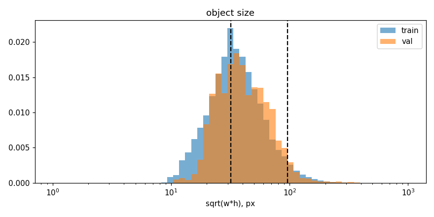
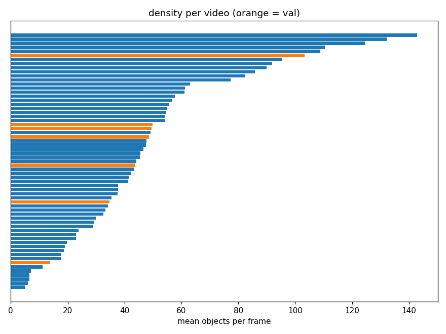
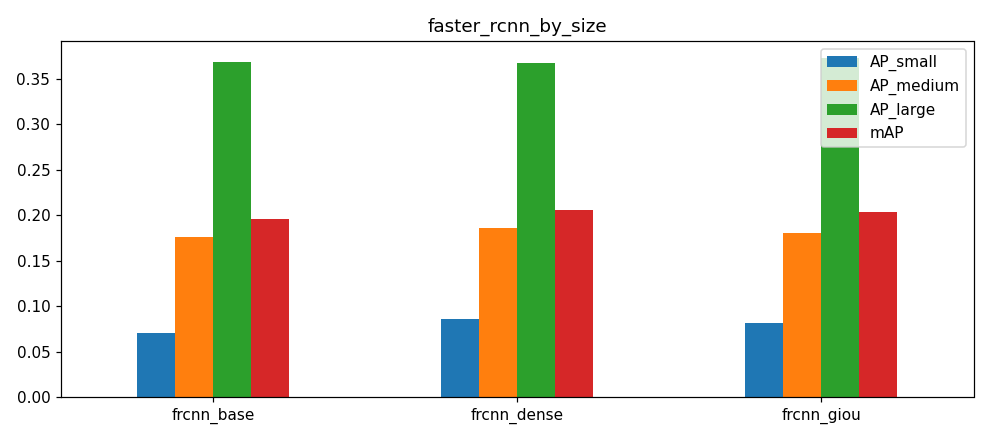
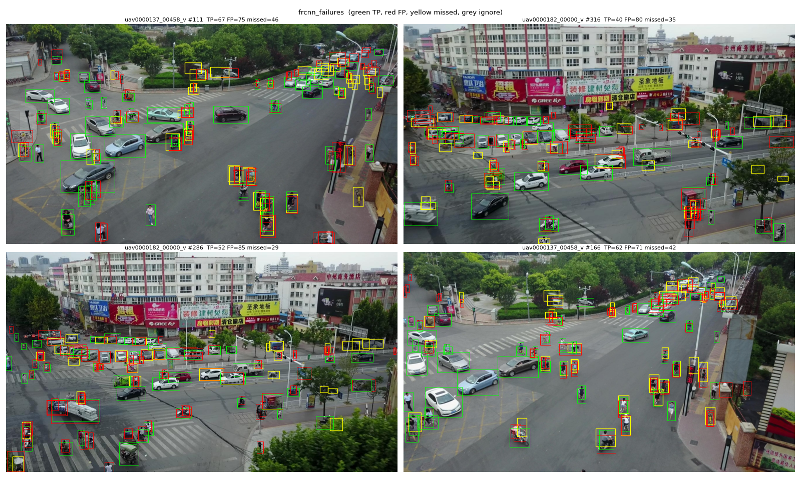
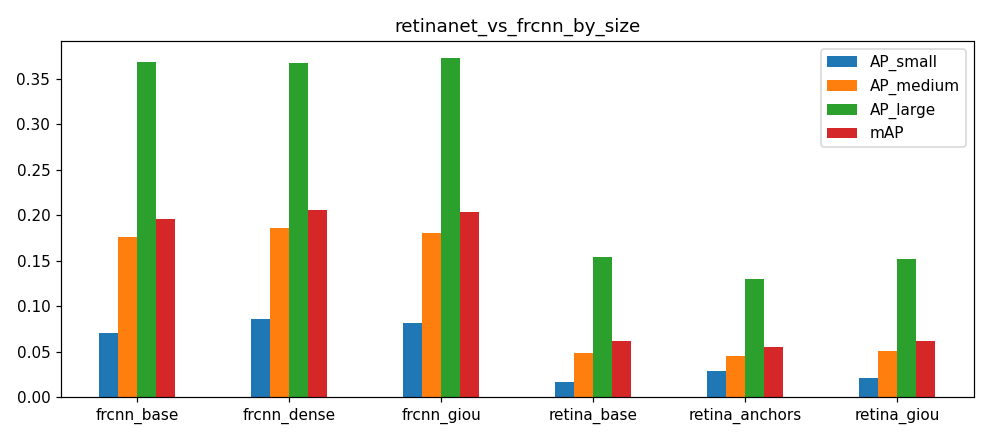
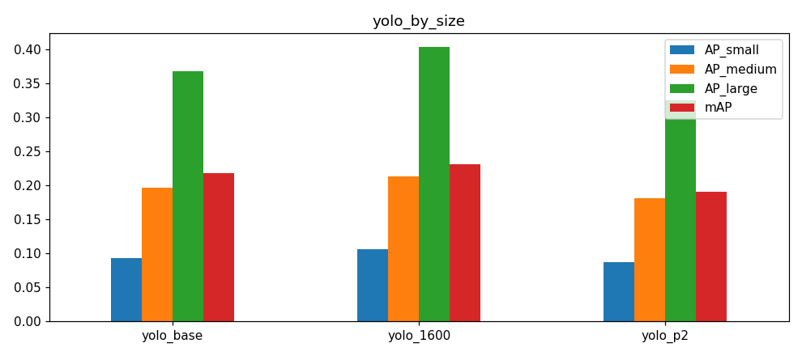
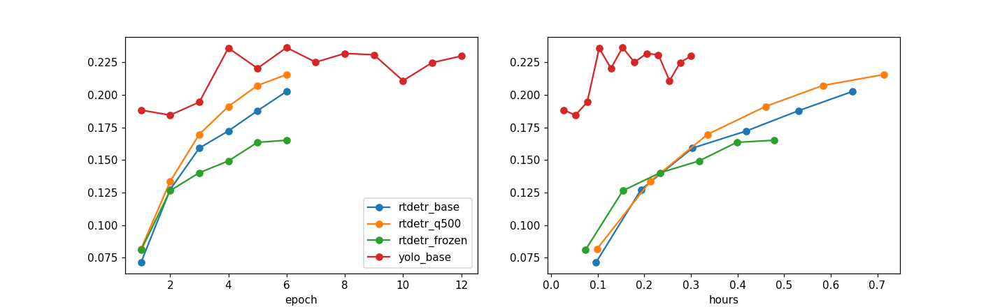
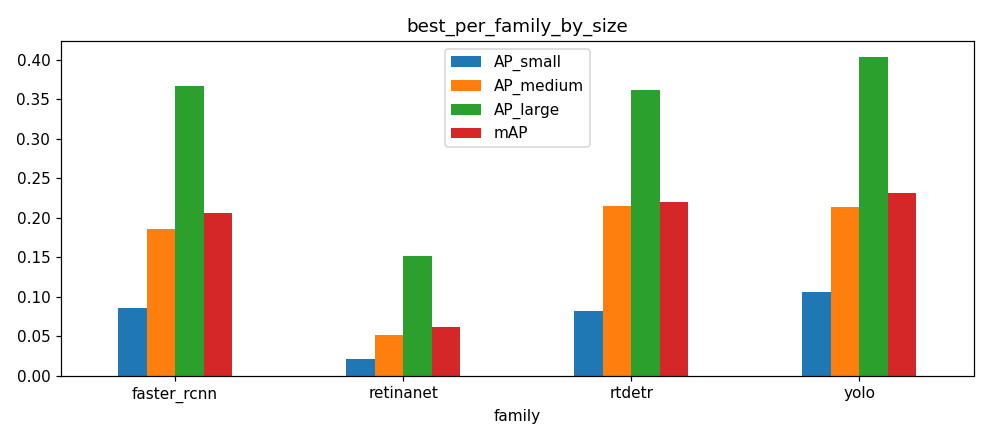

## 1. Data and preprocessing

## 2. Validation protocol

## 3. Detectors

All models: same train frames, same val split (by video), COCO mAP with up to 500 detections per frame, ignored regions as `iscrowd`. Speed is ms per frame on a Colab T4.

| Family | Run | What changed | mAP | AP50 | AP_small | AP_medium | AP_large | ms/frame |
|---|---|---|---|---|---|---|---|---|
| Faster R-CNN | frcnn_base | baseline | 0.196 | 0.401 | 0.071 | 0.176 | 0.368 | 81 |
| Faster R-CNN | frcnn_dense | RPN 3000/2000 proposals, RoI positive fraction 0.5 | **0.206** | 0.428 | 0.086 | 0.186 | 0.367 | 88 |
| Faster R-CNN | frcnn_giou | + GIoU box loss | 0.204 | 0.422 | 0.082 | 0.181 | 0.373 | 91 |
| RetinaNet | retina_base | baseline | 0.061 | 0.119 | 0.017 | 0.049 | 0.154 | 77 |
| RetinaNet | retina_anchors | anchors from data | 0.055 | 0.141 | 0.028 | 0.046 | 0.130 | 79 |
| RetinaNet | retina_giou | GIoU box loss | **0.062** | 0.120 | 0.021 | 0.051 | 0.152 | 79 |
| YOLOv8s | yolo_base | baseline, 1280 | 0.218 | 0.417 | 0.093 | 0.196 | 0.368 | 31 |
| YOLOv8s | yolo_1600 | input 1600 | **0.231** | 0.452 | 0.106 | 0.213 | 0.404 | 48 |
| YOLOv8s | yolo_p2 | + P2 head, 1280 | 0.191 | 0.395 | 0.087 | 0.181 | 0.326 | 42 |
| RT-DETR-L | rtdetr_base | baseline, 300 queries | 0.206 | 0.381 | 0.074 | 0.201 | 0.337 | 150 |
| RT-DETR-L | rtdetr_q500 | 500 queries | **0.220** | 0.420 | 0.082 | 0.215 | 0.362 | 153 |
| RT-DETR-L | rtdetr_frozen | frozen backbone | 0.170 | 0.325 | 0.070 | 0.171 | 0.279 | 153 |

### 3.1 Two-stage: Faster R-CNN

### 3.2 One-stage anchor-based: RetinaNet

### 3.3 One-stage anchor-free: YOLOv8

### 3.4 Query-based: RT-DETR

## 4. Final pipeline

Starting point: yolo_1600. Score = 0.84 · mAP + 0.16 · mAP on val downscaled to 680 px.

| Step | Variant | mAP | mAP_680 | score | AP_small |
|---|---|---|---|---|---|
| Inference | plain | 0.231 | 0.139 | 0.217 | 0.106 |
| Inference | NMS 0.5 | 0.231 | 0.139 | 0.216 | 0.105 |
| Inference | NMS 0.7 | 0.232 | 0.137 | 0.216 | 0.107 |
| Inference | input +320 (1920) | 0.244 | 0.129 | **0.226** | 0.116 |
| Inference | TTA | 0.237 | 0.149 | 0.223 | 0.102 |
| Inference | 2x2 tiles + full frame | 0.227 | 0.118 | 0.209 | 0.135 |
| Data | ignored regions greyed out | 0.241 | 0.145 | 0.226 | 0.133 |
| Model | YOLOv8m (greyed-out data) | 0.248 | 0.154 | **0.233** | 0.123 |
| Final | YOLOv8m + input 1920 | 0.286 | 0.121 | 0.259 | 0.125 |

## 5. Leaderboard

| Submission | Public LB | Private LB |
|---|---|---|
| | | |

## 6. Final model and how to run

## 7. Conclusions

## References
