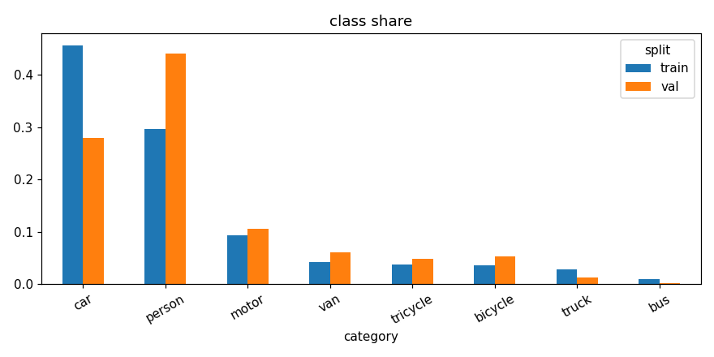
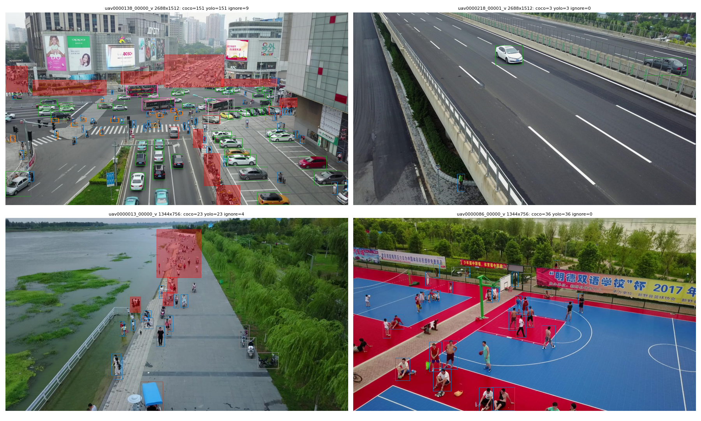
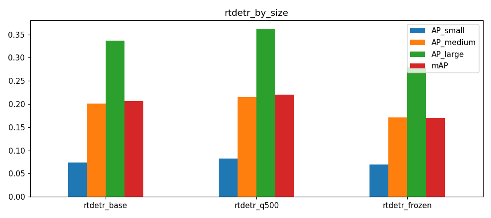

## 1. Data and preprocessing

The dataset VisDrone contains videos taken by drones and the task is to detect 8 types of objects (person, bicycle, car, van, truck, bus, motor, tricycle). Train has 24201 photos from 56 videos, validation has 2846 frames from 7 videos, and the test set has 3811 photos from 48 videos. Train and validation come from different videos.

Classes are imbalanced: cars make up 46% of train boxes, while people are 30% and buses 0.9%. The validation set has a different mix, with 44% of people, 28% of cars and 0.2% of buses. Because of this, class of buses will have low AP and the validation score depends a lot on how well the model handles the more common classes in val

Most objects small in frame in the frame: 24% of boxes are smaller than 32×32 px and 64% are between 32 and 96 px, other 12% are large (>96x96px). If photos are resized to 640 px, 54% of the objects become smaller than 16 px, which is too little for the detector to see. At 1280 px this drops to 9.7%, so we train at 1280 even though it is slower. Also tried 1600px for YOLO but it was slower and took more GPU memory, but it gave better mAP.

On average there are 46 objects per frame in train and 40 in val, but some photos have up to 180. Density also depends a lot on the video: some video have only 5 objects, others can have crowds with nuch more objects. Because of this we allow up to 500 detections per frame instead of the usual 100 and for RT-DETR tried 500 queries instead of 300.

Some frames have areas where objects were not labelled and objects of class 'other'; I mark them as crowd regions and detections there are not marked as errors. To check the label conversion I drew the boxes on several frames and compared box counts between COCO and YOLO. Neighbouring frames from one video are very similar, so I keep every 20th frame (1238 in total) in train and every 5th (571 in total) in validation. All frames are resized to at most 1600 px, I use flips for Faster R-CNN and RetinaNet, mosaic for YOLO and RT-DETR and fix the random seed to 42. About 16% of test frames are much smaller than anything in train, which are taken into account later.

## 2. Validation protocol

I use one fixed split: 56 videos for training and 7 videos for validation, and every model is evaluated on the same validation frames (571 frames). The split is by video, because frames from one video look alike and a random split would leak them into validation. I did not use k-fold because training each model several times did not fit into the GPU time. I report metric COCO mAP, AP50, AP_small computed with pycocotools up to 500 detections per frame. The main risk is that 7 videos is a small validation set and its mix differs from train (val has 44% of people vs 30% in train)

## 3. Detectors

All models: same train frames, same val split (by video), COCO mAP with up to 500 detections per frame, ignored regions as `iscrowd`. Speed is ms per frame on a Colab T4.

| Family | Run | What changed | mAP | AP50 | AP_small | AP_medium | AP_large | ms/frame |
|---|---|---|---|---|---|---|---|---|
| Faster R-CNN | frcnn_base | baseline | 0.196 | 0.401 | 0.071 | 0.176 | 0.368 | 81 |
| Faster R-CNN | frcnn_dense | RPN 3000/2000 proposals, RoI positive fraction 0.5 | **0.206** | 0.428 | 0.086 | 0.186 | 0.367 | 88 |
| Faster R-CNN | frcnn_giou | + GIoU box loss | 0.204 | 0.422 | 0.082 | 0.181 | 0.373 | 91 |
| RetinaNet | retina_base | baseline | 0.061 | 0.119 | 0.017 | 0.049 | 0.154 | 77 |
| RetinaNet | retina_anchors | anchors from data | 0.055 | 0.141 | 0.028 | 0.046 | 0.130 | 79 |
| RetinaNet | retina_giou | GIoU box loss | **0.062** | 0.120 | 0.021 | 0.051 | 0.152 | 79 |
| YOLOv8s | yolo_base | baseline, 1280 | 0.218 | 0.417 | 0.093 | 0.196 | 0.368 | 31 |
| YOLOv8s | yolo_1600 | input 1600 | **0.231** | 0.452 | 0.106 | 0.213 | 0.404 | 48 |
| YOLOv8s | yolo_p2 | + P2 head, 1280 | 0.191 | 0.395 | 0.087 | 0.181 | 0.326 | 42 |
| RT-DETR-L | rtdetr_base | baseline, 300 queries | 0.206 | 0.381 | 0.074 | 0.201 | 0.337 | 150 |
| RT-DETR-L | rtdetr_q500 | 500 queries | **0.220** | 0.420 | 0.082 | 0.215 | 0.362 | 153 |
| RT-DETR-L | rtdetr_frozen | frozen backbone | 0.170 | 0.325 | 0.070 | 0.171 | 0.279 | 153 |

Learning settings: 
- Faster R-CNN and RetinaNet: optimizer SGD, momentum 0.9, 4 epochs, batch 4, mixed precision (AMP); taken best epoch by val mAP
- YOLOv8: 12 epochs, optimizer SGD, lr 0.01, batch 8 (for 1280), 4 (for 1600 and P2)
- RT-DETR-L: 6 epochs, optimizer AdamW, lr 0.0001, batch 4.

### 3.1 Two-stage: Faster R-CNN

The frcnn_dense experiment improved mAP from 0.196 to 0.206 and AP_small from 0.071 to 0.086. I increased the number of RPN proposals and the percentage of positive RoIs because the frames contain many objects. Inference time also increased from 81 to 88 ms per image. The frcnn_giou experiment replaced Smooth L1 loss with GIoU loss, but mAP dropped from 0.206 to 0.204. Maybe this happened because positive RoIs already overlap well with real objects. Also, 4 training epochs might not be enough for the new loss to help.

The RPN proposes boxes where an object might be. The second stage gives each box a class (one of eight classes or background) and makes the box more exact. RPN recall at IoU 0.5 grows from 0.67 with 100 proposals to 0.90 with 1000 proposals and then stays the same at 2000. This means that RPN misses about 10% of objects, mostly small ones. The second stage cannot detect them because it does not receive their boxes. So adding more proposals will not help much. A better way is to improve how the model detects small objects, for example by using higher-resolution features.

AP is lowest for small objects (0.07–0.09) and highest for large objects (around 0.37). The frcnn_dense experiment mostly helped small objects, increasing AP_small from 0.071 to 0.086, while AP_large stayed almost the same.

**Failure cases**
1. Small cars at the far end of the street: The model misses many cars and makes some false detections, probably because the cars are very small and too close to each other.
2. People on motorcycles and scooters: Some objects have both red and yellow boxes. The model may predict the wrong class or box, probably because the person and motorcycle overlap a lot.
3. Parked cars behind fences and trees: The model misses some cars in the row, probably because parts of them are hidden by fences or trees and the cars are parked close together.

### 3.2 One-stage anchor-based: RetinaNet

Default anchors start at 32 px and use aspect ratios of 0.5, 1, and 2. I chose the smallest anchor using the power of two closest to the 5th percentile of object sizes, limited to 8–32 px. I also used three anchor sizes per level and chose three aspect ratios using k-means on log(h/w) values from the training data.

RetinaNet reached a maximum mAP of 0.062 with GIoU loss. Data-based anchors improved AP50 from 0.119 to 0.141 and AP_small from 0.017 to 0.028, but mAP dropped from 0.061 to 0.055. The model was still learning after four epochs, so it probably needed more training time. It also missed 82% of small objects.

Without an RPN, RetinaNet checks hundreds of thousands of anchors per image, and most of them are background. Focal loss reduces the effect of easy background examples, but the model still needs more training. In Faster R-CNN, the RPN first removes most of the background proposals.

### 3.3 One-stage anchor-free: YOLOv8

YOLOv8 does not use anchors. Each grid point predicts an object class and distances to the four sides of a box. The Task-Aligned Assigner selects positive points using classification scores and IoU. This avoids manually choosing anchor sizes, but very small objects can fall into the same grid cell at stride 8, so I also tested a P2 head with stride 4.

I tested input sizes of 1280 and 1600 and also tried adding a P2 head. YOLOv8 with 1600 input gave the best result, with mAP 0.231 and AP_small 0.106. The P2 version reached only 0.191, because 12 epochs were not enough to train the new head. YOLOv8 was also fast at 31 ms per image (for 1280) and performed better than Faster R-CNN and RetinaNet across all object sizes.

### 3.4 Query-based: RT-DETR

RT-DETR matches each object to only one query during training. This helps avoid duplicate predictions, so NMS is not needed. But training can be slower because only matched queries can learn how to find objects.

Increasing the number of queries from 300 to 500 improved mAP from 0.206 to 0.220. This probably helped because some validation frames contain up to 116 objects. Freezing the backbone made the result worse, dropping mAP to 0.170.

YOLO reached a plateau around epoch 4, while RT-DETR was still improving after 6 epochs. This means RT-DETR did not fully converge within the training budget. YOLO also performed better on small objects (0.106 vs 0.082) and was much faster, taking 31 ms per image (for 1280) compared to around 150 ms for RT-DETR.

YOLOv8 1600 performed best on small objects (AP 0.106) and large objects (AP 0.404). RT-DETR was slightly better on medium objects (0.215 vs 0.213 for YOLO). Overall, YOLOv8 1600 has the best result (with considered detection quality and speed)

## 4. Final pipeline

Starting point: yolo_1600. Score = 0.84 · mAP + 0.16 · mAP on val downscaled to 680 px.

About 16% of test frames have a lower resolution (680×382 or 960×540), but there are no such frames in validation. So I also evaluate on a copy of validation resized to 680 px and combine both mAP values with weights 0.84 and 0.16, based on the proportion of large and small frames in the test set.

| Step | Variant | mAP | mAP_680 | score | AP_small |
|---|---|---|---|---|---|
| Inference | plain | 0.231 | 0.139 | 0.217 | 0.106 |
| Inference | NMS 0.5 | 0.231 | 0.139 | 0.216 | 0.105 |
| Inference | NMS 0.7 | 0.232 | 0.137 | 0.216 | 0.107 |
| Inference | input +320 (1920) | 0.244 | 0.129 | **0.226** | 0.116 |
| Inference | TTA | 0.237 | 0.149 | 0.223 | 0.102 |
| Inference | 2x2 tiles + full frame | 0.227 | 0.118 | 0.209 | 0.135 |
| Data | ignored regions greyed out | 0.241 | 0.145 | 0.226 | 0.133 |
| Model | YOLOv8m (greyed-out data) | 0.248 | 0.154 | **0.233** | 0.123 |
| Final | YOLOv8m + input 1920 | 0.286 | 0.121 | 0.259 | 0.125 |

With the same model weights, changing NMS from 0.5 to 0.7 has almost no difference (mAP 0.231–0.232). Tiling improved AP_small from 0.106 to 0.135, but overall mAP dropped to 0.227, because of duplicate boxes near tile borders. Increasing the input size to 1920 gave the best normal validation mAP (0.244), but mAP_680 dropped from 0.139 to 0.129. TTA worked better on small frames (mAP_680 0.149), but the 1920 input still had the highest combined score (0.226 vs 0.223).

I filled ignored regions in the training frames with gray, without changing the YOLOv8s 1600 model and run the model again. This improved mAP from 0.231 to 0.241, AP_small from 0.106 to 0.133, and the combined score from 0.217 to 0.226, because objects without labels in ignored regions no longer give the model confusing training signals.

The larger YOLOv8m model trained on masked data reached mAP 0.248 and a combined score of 0.233, the best result among the model experiments. For the final pipeline, I used YOLOv8m with 1920 input, which reached mAP 0.286 on normal validation, but only 0.121 on the resized validation set. This is a risk because the public leaderboard also showed that yolo_1600 (0.2674) performed worse than yolo_base (0.2829), even though it was better on validation. A smaller input or TTA for low-resolution frames might be safer. But in private leaderboard yolo_1600 works better then yolo_base

## 5. Leaderboard

| Submission | Public LB | Private LB |
|---|---|---|
| yolo_base | 0.2829 | 0.2121 |
| yolo_1600 | 0.2674 | 0.2159 |

My best submission reached 0.2159 on the private leaderboard, placing 56th and scoring above the baseline. The final pipeline was not submitted before the competition closed, so I only have validation results for it.

## 6. Final model and how to run

The final model is YOLOv8m, trained on frames with gray-masked ignored regions and using an input size of 1920 for inference.

- Environment: Google Colab with T4 GPU.
- Run: In hw2.ipynb
- Data: Kaggle API token.
- Outputs: Results are saved to Google Drive. The final submission file is MyDrive/hw2/submission.csv, created in section 10.
- Dependencies: ultralytics, pycocotools, and kaggle are installed in the second cell. PyTorch and torchvision are already available in Colab.
- Settings and seed: Seed 42, TRAIN_STEP=20, VAL_STEP=5, MAX_SIDE=1600, IMGSZ=1280. Training epochs: 4 for torchvision models, 12 for YOLO, and 6 for RT-DETR. These settings are defined in the first cell.
- Re-running: Models already saved in MyDrive/hw2/runs are loaded instead of being trained again.
-  Submitted file: The submission with private leaderboard score 0.2159 was created in section 8 (yolo_1600)

## 7. Conclusions

Increasing the input size, masking ignored regions, and using a larger YOLO model helped improve detection results. Increasing the number of RPN proposals also improved Faster R-CNN (for small objects). GIoU loss did not help, and RetinaNet probably needed more training time. Small and crowded objects were still the hardest to detect, so next I would test different input sizes for low-resolution frames and train the models for more epochs.

## References

- [VisDrone](https://arxiv.org/abs/2001.06303)
- [Faster R-CNN](https://arxiv.org/abs/1506.01497)
- [Feature Pyramid Networks](https://arxiv.org/abs/1612.03144)
- [RetinaNet / Focal Loss](https://arxiv.org/abs/1708.02002)
- [YOLOv2 (k-means anchors)](https://arxiv.org/abs/1612.08242)
- [GIoU](https://arxiv.org/abs/1902.09630)
- [TOOD (task-aligned assigner)](https://arxiv.org/abs/2108.07755)
- [Ultralytics YOLO](https://docs.ultralytics.com)
- [DETR](https://arxiv.org/abs/2005.12872)
- [RT-DETR](https://arxiv.org/abs/2304.08069)
- [SAHI (sliced inference)](https://arxiv.org/abs/2202.06934)
- [COCO detection metrics](https://cocodataset.org/#detection-eval)
- [pycocotools](https://github.com/cocodataset/cocoapi)
- [torchvision detection models](https://docs.pytorch.org/vision/stable/models.html#object-detection-instance-segmentation-and-person-keypoint-detection)